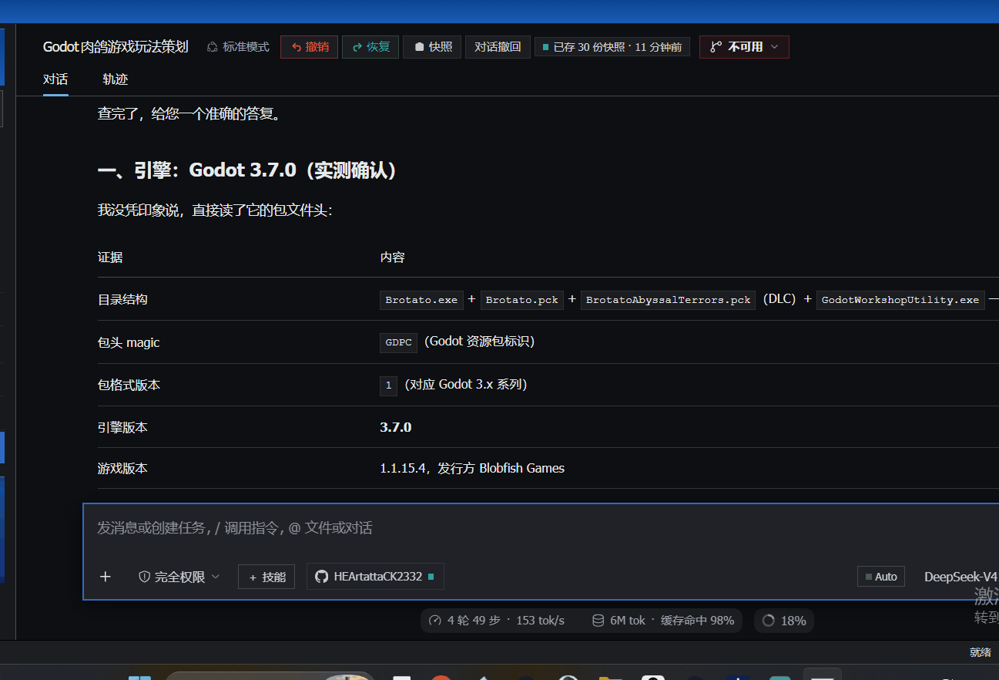

# dsh-text-explain（划词解释）

[English](README.md) ｜ 简体中文

**不懂 AI，也看得懂 AI 在说什么。**
在 DeepSeek Harness 的对话里划中一段看不懂的话——一个术语、一条报错、一屏黑话——
就地得到一段大白话的解释。



*41 秒，未剪辑：一段 Godot 打包文件被讲成「`.exe` 是牛，`.pck` 是行李箱——牛和行李箱得一起走」，随后两次追问。*

## 为什么做它

AI 的输出里塞满了「默认你已经懂」的词。常规建议是「直接问模型嘛」——可你得先知道**该问什么**，
而回答往往又拐回同一套黑话。

这个插件把那一步省掉：**划中看不懂的地方，点一下，读大白话版本。**
不用组织提示词，不用另开窗口，不用配 API Key。

## 功能

- **带语境理解**：划词时会连「这段话所在的那条完整消息」一起读走，一并交给模型。
  「最后由它打款」单看没头没尾，带上语境就知道「它」指财务部门。
- **难度旋钮（讲给谁听）**：四档——**小白 / 通识 / 专业 / 深研**，默认「小白」。
  换一档，它会**立刻把当前这问重讲一遍**：同一句话，前一眼是生活里的比方，后一眼是工程术语。
  弹窗里换的那一下只管本次；想「以后都这样」，到设置页选好再按保存。
- **待命式交接（✦ 新建为对话）**：把原文、它所在的消息、以及已经问过的内容打包成一份「交接单」，
  送进一个新会话并自动跳过去。**新会话只回一句「背景已了解，等你开口」就等着**——
  不总结、不提问、不展开。解释您已经听过了，新会话是留给「接下来要做什么」的。
- **Markdown 渲染**：标题、列表、引用、代码块、**表格**、链接都能正常显示——
  手写零依赖渲染器，用 React 元素build，从根上防 XSS。
- **联网与本地文件（可选）**：两个开关，开启后模型可调用 `web_search` / `web_fetch`
  查最新信息，或用 `search_files` / `read_file` 翻您本地的文档。

## 安装

```sh
dsh plugin --profile web add github:HEArtattaCK2332/dsh-text-explain
```

然后重启 Web profile，让新的 bundle 层载入。

<details>
<summary>从本地目录安装</summary>

```sh
dsh plugin --profile web add file:<dsh-text-explain 的路径>
```

</details>

## 用法

1. 在任意一条对话消息里**划中文字**——弹窗会自动把这条消息当语境带上。
2. 点 **AI 解释** 让它讲，或点 **追问** 就这段提个问题。
3. 看着答案流式输出；在输入框继续追问、回车即可接着聊；点 ✕ 关闭。
4. 用弹窗底部的 **讲给谁听** 换深度，换了会**立刻重讲**当前这一问。
5. 需要查网或翻本地文件，先在底部打开 **🌐 联网** / **📄 读文件**。
6. 这一摊值得继续，就点 **✦ 新建为对话**：整段问答会作为一份**交接单**进入新会话，
   自动跳过去，然后它安静等你开口。
7. 打开 **设置 → 划词解释** 设默认值：新会话落在哪个工作区、默认深度，
   以及（在「高级设置」里）两个开关的初始状态。

## 设置存在哪

存在**宿主侧**的 `<DSH_HOME>/text-explain/settings.json`（`DSH_HOME` 缺省是 `~/.dsh`）。
设置页保留一份**草稿**：每次点选只改草稿，按 **保存** 才整份写进文件，
按 **刷新** 则丢掉草稿、重新读一次。**不点保存，磁盘上不会多一个字**——
配置文件里不会，浏览器里也不会（这个插件在浏览器端不存任何东西）。

## 自检

三份「桩测试」随包出货，只依赖 Node 内置模块——不用装测试框架、不用 `npm install`：

```sh
node test/run-all.mjs         # 三份一起跑；也可单跑任一份
```

- `test/host.test.mjs` —— 用假的 `llm` / `webServer` 真跑 HTTP 端点：四档必须产出四份
  **互不相同**的系统提示词；传了不认识的 `level` 必须回落 `plain`（而非报错）；
  语境仍要注入；空选段要被拒。设置端点则验：没保存过时磁盘上不该有文件、
  脏数据会被洗净、非法负载不会改动已存的那份。测试全程写进临时 `DSH_HOME`，绝不碰真实的。
- `test/settings.test.mjs` —— 在 React / fetch 桩上真加载 `lib/client.js`：
  模块结构、插槽注册、设置归一化、缓存行为、失败兜底，以及那条要紧的规矩——
  **只有「保存」会发 POST**。桩里的 `window` 故意**不提供** `localStorage`，用来证明浏览器存储真的退场了。
- `test/render.test.mjs` —— 在 React 桩上真渲染两个组件：设置页（加载 / 就绪 / 读不到三态，
  收起与展开）与弹窗（含一段完整 Markdown 回答，顺带走一遍手写渲染器）。

## 设计说明

- 划中的文字默认送给 `deepseek-official` 的 `deepseek-v4-flash`；本插件不另存 API Key。
- 刻意零依赖、全手写：**没有构建步骤**。
- **宿主半**（`lib/index.js`）把 `POST /api/text-explain` 与
  `GET/POST /api/text-explain/settings` 注册为 **exact 路由**。四档提示词共用一副骨架
  （「语境」「格式」是公共段，只有「读者 + 怎么讲」分档），故一套代码路径服务四档。
- **语境**取自 DOM：客户端从选区锚点向上，找到「仍属于同一条消息」的最外层祖先
  （上限 4000 字）。这一步失败也不影响解释，只是没有语境。
- **联网搜索**走 Bing 的 RSS 端点（`format=rss`）——不需 API Key，且在 DuckDuckGo 不通的网络里也能用。
  `web_fetch` 会把 HTML 剥成纯文本：静态页可用，JS 渲染的页不行。
- **`search_files`** 只返回文档文件（README / SKILL.md / package.json 等），
  并跳过 `undo`、`snapshots`、`logs` 这类运行数据目录；**`read_file`** 拒绝超过 512 KB 的文件、
  长文会截断，且只读不写。
- **跨来源调用**（为将来的浏览器扩展留的门）：端点先看 `Origin`。没有 Origin、
  或与宿主同源，一切照旧；只有命中 `allowedOrigins` 白名单的来源才拿到 CORS 头，
  其余一律 **403**——免得陌生网页偷烧您的额度。白名单默认为空数组，
  所以**默认行为与从前完全一致**。

## 许可

MIT —— 见 [LICENSE](LICENSE)。
